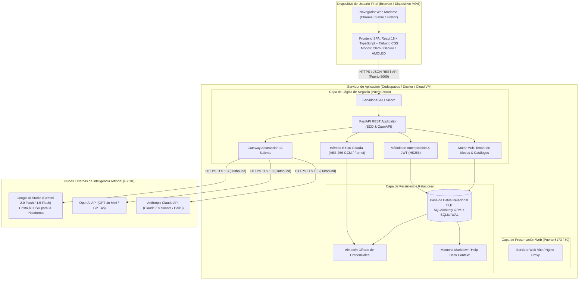

# Documento 10: Diagrama de Despliegue de Arquitectura

> **Proyecto:** CaseFlow — Plataforma Inteligente Multi-Tenant de Mesas de Ayuda  
> **Institución:** Universidad Surcolombiana (USCO) — Programa de Ingeniería de Software  
> **Asignatura:** Ingeniería de Software – Electiva 1  
> **Docente Supervisor & Product Owner:** Eduardo Martínez Vidal  
> **Equipo de Trabajo:** Danna Nerieth Palencia & Jairo Molano Salgado  
> **Evento:** INNOVASOFT IX Versión (19 de noviembre de 2026)  

---

## 1. Visión General del Despliegue

La solución adopta una arquitectura desacoplada Cliente-Servidor (no monolítica), dividida en nodos independientes:
1. **Frontend Tier (Cliente SPA):** React 18 + Vite + TypeScript + Tailwind CSS servido mediante servidor web estático o Vite Dev Server en local / Cloud (Vercel / Render / Docker).
2. **Backend API Tier (Servidor REST):** FastAPI + SQLAlchemy + Uvicorn ejecutado en contenedor Docker o entorno virtual Linux.
3. **Persistence Tier:** Base de datos relacional SQLite (concurrente WAL) o PostgreSQL en producción, con bóveda cifrada AES-256 para almacenamiento seguro de credenciales.
4. **External AI Services (BYOK Tier):** Google Gemini API, OpenAI API y Anthropic Claude API comunicados mediante TLS 1.3 saliente directo bajo demanda del usuario.

---

## 2. Diagrama de Despliegue (UML Deployment Diagram)

---

## 3. Especificación de Protocolos y Puertos

| Componente | Protocolo | Puerto Predeterminado | Propósito |
| :--- | :--- | :--- | :--- |
| **Frontend SPA** | HTTP/HTTPS | `5173` (Dev) / `80` (Prod) | Entrega de interfaz gráfica reactiva trimodal |
| **Backend REST API** | HTTP/HTTPS | `8000` | Endpoints de autenticación, gestión de mesas y bóveda |
| **OpenAPI / Swagger** | HTTP | `8000/api/docs` | Documentación interactiva de la API |
| **Persistencia SQL** | IPC / TCP | Local File / `5432` | Persistencia relacional de usuarios, mesas y contextos |
| **Google Gemini API** | HTTPS / TLS 1.3 | `443` | Inferencia BYOK y prueba de latencia milimétrica |
| **OpenAI / Claude API**| HTTPS / TLS 1.3 | `443` | Inferencia BYOK y categorización de casos |

---

## 4. Consideraciones de Seguridad en el Despliegue

1. **Aislamiento de Claves:** El backend no transmite las claves de API a clientes terceros. Las claves se validan contra el proveedor oficial y se guardan cifradas.
2. **Tokens Efímeros:** La autenticación utiliza JSON Web Tokens (JWT) con firma criptográfica simétrica y caducidad definida.
3. **Zero Ingress AI:** Los servidores de CaseFlow no reciben llamadas entrantes de los modelos de IA; toda la comunicación es estrictamente cliente-servidor saliente autenticada.
