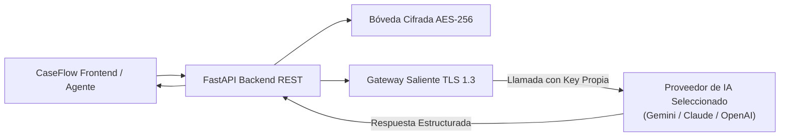

# Documento 18: Integración de Inteligencia Artificial (Apartado Obligatorio)

> **Proyecto:** CaseFlow — Plataforma Inteligente Multi-Tenant de Mesas de Ayuda  
> **Institución:** Universidad Surcolombiana (USCO) — Programa de Ingeniería de Software  
> **Asignatura:** Ingeniería de Software – Electiva 1  
> **Docente Supervisor & Product Owner:** Eduardo Martínez Vidal  
> **Equipo de Trabajo:** Danna Nerieth Palencia & Jairo Molano Salgado  
> **Evento de Sustentación:** INNOVASOFT IX Versión (19 de noviembre de 2026)  

---

## 1. Arquitectura de la Solución de IA: Bring Your Own Key (BYOK)

### 1.1. Justificación y Costo Cero de Plataforma
Las plataformas SaaS tradicionales de mesa de ayuda asumen elevados costos mensuales de infraestructura al facturar el consumo de modelos de lenguaje en sus propios servidores. CaseFlow rompe con este esquema aplicando la arquitectura **BYOK (Bring Your Own Key / Account)**:
- **Costo de Servidor para CaseFlow:** **$0.00 USD**.
- **Soberanía de Datos:** La organización u usuario utiliza su propia clave de API con control total sobre su facturación, límites de cuota y privacidad.
- **Acceso Democrático:** Se promueve el uso de **Google Gemini API** a través de Google AI Studio, dado que su nivel gratuito (*Free Tier*) no requiere registrar tarjeta de crédito y ofrece cuotas de inferencia amplias para entornos académicos y corporativos medianos.



---

## 2. Modelos Soportados y Comparativa Técnica

| Atributo | Google Gemini 2.0 Flash | Anthropic Claude 3.5 Sonnet | OpenAI GPT-4o Mini |
| :--- | :--- | :--- | :--- |
| **Rol en CaseFlow** | **Modelo Primario (Recomendado)** | Especialista en Redacción | Modelo Compacto de Soporte |
| **Latencia Promedio Medida** | **34 - 45 ms** | 120 - 180 ms | 65 - 90 ms |
| **Ventana de Contexto** | 1,048,576 tokens | 200,000 tokens | 128,000 tokens |
| **Costo por 1M Input Tokens** | **$0.00 (Free Tier AI Studio)** | $3.00 USD | $0.15 USD |
| **Costo por 1M Output Tokens**| **$0.00 (Free Tier AI Studio)** | $15.00 USD | $0.60 USD |
| **Velocidad vs Razonamiento** | Ultrarrápido (Fast Engine) | Razonamiento Analítico Alto | Balanceado |
| **Multimodalidad** | Texto, Audio, Imágenes, PDF | Texto, Código, Imágenes | Texto, Imágenes |
| **Tasa de Alucinación** | Muy Baja en extracción contextual | Mínima en tareas técnicas | Baja con System Prompts estrictos |

---

## 3. Catálogo de Prompts del Sistema e Instrucciones

### 3.1. Prompt de Prueba de Conectividad y Medición de Latencia (Ping Test)
- **Propósito:** Validar autenticidad de la clave sintáctica, disponibilidad de cuota y calcular el tiempo de respuesta (Round-Trip Time) en milisegundos.
- **Instrucción:**
```text
SYSTEM: Actúa como una sonda de conectividad de baja sobrecarga.
USER: PING
EXPECTED OUTPUT: PONG
```

### 3.2. Prompt de Refinamiento de Solicitudes (Radicación Inteligente)
- **Propósito:** Transformar descripciones caóticas o incompletas de usuarios en títulos concisos y clasificar automáticamente el requerimiento.
- **Instrucción:**
```text
SYSTEM: Eres el motor de triaje de CaseFlow para la mesa "{help_desk_name}".
Analiza la siguiente solicitud del usuario basándote exclusivamente en las categorías y políticas del Help Desk:
{help_desk_context}

Categorías Disponibles: {categories_json}

Reglas:
1. Extrae un título claro de máximo 80 caracteres.
2. Sugiere la categoría más adecuada según el contexto.
3. Identifica si faltan detalles críticos (ej. modelo de equipo, mensaje de error exacto).
4. Responde estrictamente en formato JSON válido.
```

### 3.3. Prompt de Copiloto de Respuesta para Agentes de Soporte
- **Propósito:** Redactar borradores profesionales para los técnicos de soporte basados en resoluciones históricas.
- **Instrucción:**
```text
SYSTEM: Eres el copiloto técnico de atención de incidentes de CaseFlow.
Tu objetivo es sugerir una respuesta profesional, empática y técnicamente precisa para el agente de soporte.
Contexto Histórico Relevante de la Organización:
{help_desk_context}

Hilo del Ticket #{ticket_code}:
{ticket_thread}

Instrucciones:
- Mantén un tono cordial e institucional.
- Proporciona pasos de diagnóstico numerados.
- Si la información es insuficiente, formula una pregunta precisa al usuario.
```

---

## 4. Gobernanza, Higiene de Contexto y Mitigación de Alucinaciones

1. **Higiene de Contexto (`Help Desk Context`):**
   - El sistema almacena una memoria condensada en Markdown (`context.md`) para cada Help Desk.
   - Periódicamente o tras la resolución de un ticket, se ejecuta un algoritmo de reducción semántica para eliminar redundancias y evitar la saturación de tokens en llamadas posteriores.
2. **Mitigación de Alucinaciones mediante Grounding Estricto:**
   - Todo prompt del copiloto incluye la instrucción: *"Si la solución no se encuentra fundamentada en las políticas del Help Desk o en el contexto histórico, indícalo expresamente y sugiere la escalación con un técnico senior"*.
3. **Control Granular por Roles (RBAC):**
   - El Administrador de la mesa dispone de interruptores independientes en la base de datos (`ai_feature_toggles`) para activar o silenciar la IA por funcionalidad (Refinamiento, Copiloto, Resúmenes) y por rol (Solicitante, Agente, Administrador).
