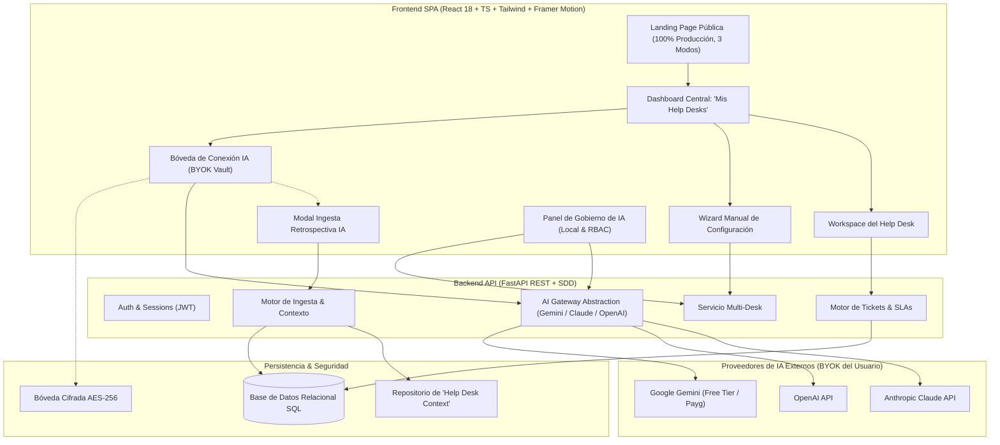

# Plan Maestro y Especificación de Ingeniería: CaseFlow

> **Proyecto:** CaseFlow — Plataforma Inteligente Multi-Tenant de Mesas de Ayuda  
> **Institución:** Universidad Surcolombiana (USCO) — Programa de Ingeniería de Software  
> **Asignatura:** Ingeniería de Software – Electiva 1  
> **Docente Supervisor & Product Owner:** Eduardo Martínez Vidal  
> **Evento Objetivo:** INNOVASOFT IX Versión (19 de noviembre de 2026)  
> **Equipo de Trabajo:**
> - **Danna Nerieth Palencia** (Ingeniería de Software, USCO)
> - **Jairo Molano Salgado** (Ingeniería de Software, USCO)  
> *(Equipo conjunto de ingeniería de software — Sin asignación de roles jerárquicos o específicos)*

---

## 1. Visión General del Software y Principios Fundamentales

**CaseFlow** es una plataforma web cliente-servidor no monolítica para la gestión de solicitudes, incidencias y requerimientos organizacionales (Punto Único de Contacto - SPOC), concebida para operar en entornos multi-organización y multi-departamento a través de espacios de trabajo independientes (**Help Desks**).

El sistema se rige bajo cinco pilares no negociables:

1. **Software 100% Terminado y Funcional:** No existen versiones "demo", secciones simuladas ni botones ficticios. Todos los flujos (autenticación, gestión de mesas, ciclo de vida de tickets, SLAs, catálogos y gobernanza de IA) están totalmente codificados y respaldados por una base de datos relacional y un backend REST.
2. **Arquitectura BYOK (Bring Your Own Key / Account) con Costo Cero de Servidor:** CaseFlow no cobra por inferencia ni asume costos de API de IA. La inteligencia artificial corre 100% por cuenta del usuario mediante su propia cuenta/clave de API (Google Gemini, OpenAI ChatGPT o Anthropic Claude).
3. **Autonomía Operativa Total (Fallback Manual Elegante):** Si el usuario decide no conectar una API Key de IA, el sistema es completamente autónomo y funcional. Incluye un **Onboarding Wizard** intuitivo y amigable para configurar manualmente categorías, prioridades y SLAs.
4. **Ingesta Retrospectiva al Conectar IA:** Si el usuario opera de forma manual y más adelante conecta su IA en el Dashboard, se despliega automáticamente un modal que captura el contexto organizacional y **lee todos los tickets históricos existentes** para enriquecer y estructurar el **`Help Desk Context`** fundacional.
5. **Estética "Software Craft" Anti-Cliché:** Ruptura absoluta con las plantillas genéricas de IA (cero fondos morados fluorescentes, cero chatbots intrusivos). Se adopta una estética de herramienta de ingeniería de precisión (estilo Linear/Raycast/Supabase), con **tres modos visuales** (Claro, Oscuro Normal y Oscuro AMOLED) y una **paleta Duo-Tone estricta** (Salmón/Fucsia Claro + Negro en Claro / Blanco en Oscuro).



---

## 2. Arquitectura de Inteligencia Artificial (BYOK) y Gobernanza de Contexto

### 2.1. ¿Cómo funciona la arquitectura BYOK y cuál es la mejor manera técnica?

#### El Problema de las Plataformas Tradicionales con IA:
Las plataformas que ofrecen IA típicamente asumen costos mensuales fijos o facturan costosas suscripciones SaaS para cubrir el consumo de APIs externas. Esto genera fricción económica, límites arbitrarios de uso y riesgos de insolvencia operativa.

#### La Solución Técnica Óptima implementada en CaseFlow:
CaseFlow implementa un modelo **BYOK (Bring Your Own Key / Account)** transparente y desacoplado:
1. **Conexión Directa:** El usuario introduce su propia API Key de:
   - **Google Gemini API:** (Opción altamente recomendada para la gran mayoría de usuarios, dado que Google AI Studio otorga un nivel gratuito generoso sin costo de tarjeta de crédito, con soporte para modelos como `gemini-2.0-flash` de bajísima latencia).
   - **OpenAI API:** Clave de desarrollador para modelos `gpt-4o` / `gpt-4o-mini`.
   - **Anthropic Claude API:** Clave de consola para modelos `claude-3-5-sonnet` / `claude-3-5-haiku`.
2. **Cero Almacenamiento Inseguro:** 
   - Las claves se cifran en reposo con **AES-256-GCM** en la base de datos local asociada al perfil del usuario, o pueden ser almacenadas en la sesión del navegador para máxima privacidad ("Zero-Knowledge Backend").
   - Todas las llamadas al proveedor de IA se realizan como solicitudes salientes autenticadas vía TLS directo.
3. **Validación Instantánea (Ping de Conectividad):**
   - Al registrar la clave, CaseFlow ejecuta un endpoint ligero (`/api/ai/test-connection`) que realiza una llamada de 1 token o consulta de modelos para comprobar:
     - Validez sintáctica y estado de la cuota.
     - Latencia de respuesta en milisegundos (ms).
     - Catálogo de modelos habilitados para esa clave.
4. **Cero Costo para CaseFlow:** El costo de computación de la plataforma es $0 USD. El usuario disfruta de control absoluto sobre sus propios tokens y límites de consumo.

---

### 2.2. Operación Dual: Modo Manual vs Conexión de IA Posterior

CaseFlow garantiza una experiencia completa en ambos caminos operativos:

#### A. Modo Manual (Sin Conexión de IA): Onboarding Wizard Guiado
Si el usuario crea un Help Desk sin haber conectado una clave de IA, el sistema no muestra errores ni bloqueos. En su lugar, se activa un **Onboarding Wizard** paso a paso, visual y accesible:
- **Paso 1: Identidad del Espacio:** Nombre del Help Desk (ej. "Soporte TI Facultad", "Atención al Cliente"), slug identificador único y descripción de alcance.
- **Paso 2: Catálogo de Servicios y Categorías:** Interfaz visual tipo constructor de etiquetas para añadir categorías personalizadas (ej. *Hardware*, *Software*, *Redes*, *Facturación*), con selector de color e icono representativo, o botón para aplicar un paquete base preconfigurado.
- **Paso 3: Matriz de Prioridades y Políticas de SLA:** Configuración amigable de niveles de urgencia (*Baja*, *Media*, *Alta*, *Crítica*), definiendo mediante controles deslizantes las horas límite de primera respuesta y horas de resolución.
- **Paso 4: Canales y Asignación:** Invitación de miembros y reglas básicas de enrutamiento manual.

#### B. Modo Conexión de IA Posterior: Modal de Ingesta y Contextualización
Cuando un usuario que operaba manualmente decide conectar su API Key en el Dashboard:
1. **Detección Automática:** El sistema detecta que la cuenta ahora dispone de credenciales de IA válidas.
2. **Modal Inteligente:** Al ingresar al Help Desk, se despliega el modal interactivo:  
   *"Conexión IA Detectada: Potenciar este Help Desk con Inteligencia Contextual"*.
3. **Ingesta Automática de Tickets Históricos:**
   - El sistema analiza **todos los tickets existentes** resueltos y en proceso dentro de esa mesa de ayuda.
   - Extrae patrones: problemáticas más frecuentes, vocabulario común de los solicitantes, soluciones técnicas exitosas y tiempos reales de resolución.
4. **Inyección de Directrices del Administrador:**
   - El modal permite al administrador ingresar directrices adicionales (políticas de la empresa, horarios de atención, enlaces a manuales).
5. **Síntesis del `Help Desk Context`:**
   - La IA compila esta información en un documento fundacional estructurado en Markdown (`context.md`), alojado en la base de datos de esa mesa de ayuda.
   - A partir de ese momento, cada funcionalidad de IA en esa mesa de ayuda responderá con conocimiento profundo de la historia real del departamento.

---

### 2.3. Jerarquía y Gobernanza de la IA (Dashboard vs Help Desk)

La gobernanza de la IA se divide en dos niveles claros de responsabilidad:

```
[ DASHBOARD CENTRAL ]
  ├── Bóveda de Conexión BYOK (Gemini / OpenAI / Claude)
  ├── Selector de Modelo & Test de Latencia
  └── Interruptor Global de IA por Help Desk (para Help Desks donde el usuario es Admin)
        │
        ▼
[ DENTRO DEL HELP DESK (Espacio Local) ]
  ├── Gestor y Editor en Vivo del 'Help Desk Context'
  ├── Ingesta Manual/Periódica de Nuevos Tickets Resueltos
  ├── Interruptores Granulares por Función:
  │     ├── Sugerencia de Título y Categorización en Radicación
  │     ├── Copiloto de Sugerencia de Respuestas para Agentes
  │     ├── Diagnóstico y Comparativa con Casos Anteriores
  │     ├── Resumen Ejecutivo de Conversaciones Extensas
  │     └── Detección de Sentimiento / Escalamiento Automático
  └── Interruptores Granulares por Rol (RBAC):
        ├── Habilitar / Deshabilitar todas las funciones para Solicitantes
        ├── Habilitar / Deshabilitar todas las funciones para Agentes
        └── Habilitar / Deshabilitar todas las funciones para Administradores
```

---

## 3. Dirección de Arte, Diseño UI/UX y Sistema Visual

### 3.1. Investigación y Ruptura con el "Típico Diseño IA"

El diseño de software moderno para herramientas de ingeniería (como Linear, Raycast, Supabase, Vercel y Cursor) ha dejado atrás los clichés del "diseño IA" tradicional:
- **No a los gradientes morados y púrpuras genéricos.**
- **No a las estrellas fluorescentes ni orbes flotantes sin propósito.**
- **No a los chatbots flotantes molestos en la esquina inferior derecha.**
- **No a las tarjetas infladas con sombras excesivas.**

**En su lugar, CaseFlow adopta los principios de "Software Craft" y "Precision Tooling":**
1. **Líneas Hairline Milimétricas:** Bordes de 1 píxel súper sutiles (`border-[1px] border-zinc-200` en claro, `rgba(255,255,255,0.08)` en oscuro, `border-zinc-800` en AMOLED) que delimitan superficies con precisión de máquina.
2. **Tipografía Jerárquica y Monoespaciada Estructurada:** Tipografía sans-serif moderna (Inter / Geist) con tracking ajustado en títulos, acompañada de fuentes monoespaciadas (JetBrains Mono / SF Mono) para identificadores de tickets (`CASE-104`), códigos de error, latencias (`42ms`) y temporizadores de SLA.
3. **Distribución Bento Grid:** Tableros modulares asimétricos con micro-tarjetas especializadas que permiten una alta densidad de información limpia y sin saturación.
4. **Micro-interacciones Físicas con Framer Motion:** Respuestas inmediatas al cursor, resortes físicos elásticos (damping: 25, stiffness: 300), resaltado sutil de bordes al pasar el mouse (border spotlight) y transiciones de estado fluidas.

---

### 3.2. Sistema de Tres Modos Visuales y Paleta Duo-Tone Estricta

El sistema gráfico opera estrictamente sobre **dos tonalidades principales** en armonía cromática:
1. **Color Primario / Marca:** **Salmón / Fucsia Claro** (`#FB7185` / `#F43F5E` / `#FF6B8B`), utilizado para estados activos, focos, acciones principales, acentos de SLA y elementos distintivos de CaseFlow.
2. **Color Secundario / Estructural:**
   - **En Modo Claro:** **Negro Carbón Puro** (`#09090B`), para textos principales, botones estructurales e iconografía destacada.
   - **En Modos Oscuros:** **Blanco Puro** (`#FFFFFF`), para garantizar el máximo contraste y legibilidad.

#### Los Tres Modos Visuales Implementados:

| Atributo | Modo Claro (Light) | Modo Oscuro Normal (Dark) | Modo Oscuro AMOLED (True Black) |
| :--- | :--- | :--- | :--- |
| **Lienzo de Fondo (`bg-canvas`)** | Blanco puro `#FFFFFF` | Grafito oscuro `#0F1117` | Negro absoluto `#000000` |
| **Superficie de Tarjetas (`bg-surface`)** | Marfil ultra-suave `#F8F9FA` | Carbón elevado `#161922` | Ónix profundo `#0A0A0C` |
| **Bordes (`border-subtle`)** | Gris neutro `#E4E4E7` | Blanco translúcido `rgba(255,255,255,0.08)` | Gris carbón definido `#27272A` |
| **Texto Principal (`text-primary`)** | Negro carbón `#09090B` | Blanco puro `#FFFFFF` | Blanco puro `#FFFFFF` |
| **Texto Secundario (`text-muted`)** | Gris carbón `#71717A` | Gris perla `#A1A1AA` | Gris plata `#A1A1AA` |
| **Acento de Marca (`accent-brand`)** | Salmón / Fucsia `#F43F5E` | Salmón / Fucsia Claro `#FB7185` | Salmón / Fucsia Luminoso `#FF6B8B` |
| **Efecto en Pantalla OLED** | Luminosidad diurna | Descanso visual balanceado | 0% emisión de luz en negros, ahorro total |

---

### 3.3. Landing Page de Alto Desempeño (100% Producción)

La Landing Page de CaseFlow está construida como una experiencia web completa y definitiva:
- **Cero Versión Demo o Mock:** Cada interacción en la landing page está conectada al flujo real del software.
- **Selector de Modo en Vivo (Trimodal):** Los visitantes pueden alternar en tiempo real entre Modo Claro, Oscuro Normal y Oscuro AMOLED mediante un switch táctil con animación de desplazamiento físico.
- **Demostración de la Bóveda BYOK:** Muestra interactiva de cómo funciona la conexión con Gemini, Claude o OpenAI sin costos ocultos.
- **Rendimiento y Fluidez:** Carga instantánea, animaciones aceleradas por hardware (GPU-composited), diseño 100% responsivo para móviles, tablets y monitores ultra-wide.

---

## 4. Especificación Detallada de Módulos del Software

### Módulo 1: Landing Page Pública & Auth Gateway
- **Header:** Logotipo tipográfico minimalista en negro/blanco con isotipo en salmón, enlaces a beneficios, arquitectura BYOK y selector de los 3 modos de color.
- **Hero Section:** Título de alto impacto editorial con tracking reducido, micro-píldora con estado en vivo ("v1.0.0 Ready"), botones de acción rápida ("Iniciar Sesión" y "Crear Cuenta").
- **Sección Bento Grid de Capacidades:**
  - Tarjeta 1: *BYOK Vault* — Gráfico interactivo que simula la validación de claves con latencia en milisegundos.
  - Tarjeta 2: *Help Desk Context* — Visualización del documento vivo que aprende con cada ticket.
  - Tarjeta 3: *Onboarding Wizard* — Vista del flujo manual accesible para equipos sin IA.
  - Tarjeta 4: *Zero Platform Costs* — Explicación técnica de la soberanía de datos y costo $0.
- **Formularios de Autenticación:** Modal/página de Registro e Inicio de Sesión con validación en tiempo real y tokens JWT.

---

### Módulo 2: Dashboard Central ("Mis Help Desks") & Centro BYOK
- **Barra de Estado Superior:** Perfil de usuario, selector trimodal de tema, y estado de la conexión IA (icono indicador verde para activa con proveedor y modelo, o gris para inactiva).
- **Mis Help Desks:**
  - Grilla de tarjetas bento para cada Help Desk al que pertenece el usuario.
  - Métricas en la tarjeta: Nombre, rol del usuario (Admin, Agente, Solicitante), tickets abiertos, cumplimiento de SLAs y switch de IA activo/inactivo (si es admin).
  - Botón principal de acción: `"+ Nuevo Help Desk"`.
- **Centro de Conexión IA (BYOK Vault):**
  - Selector de proveedor: Google Gemini, OpenAI, Anthropic Claude.
  - Campo de entrada seguro de API Key con opción de revelado temporal.
  - Selector dinámico de modelo obtenido tras la validación de la clave.
  - Botón *"Probar Conexión & Medir Latencia"*: valida las credenciales contra la API oficial en vivo.
  - Estadísticas de uso local (contador de tokens acumulados de la sesión).

---

### Módulo 3: Flujo de Onboarding & Modal de Ingesta Retrospectiva
- **Creación de Help Desk - Flujo Manual (Onboarding Wizard):**
  - Flujo por pasos animados con barra de progreso estilizada en salmón.
  - Paso a paso guiado para configurar nombre, categorías, prioridades y tiempos de respuesta.
- **Modal de Ingesta Retrospectiva de Tickets (Trigger de Conexión IA):**
  - Se activa automáticamente al detectar una nueva API Key conectada cuando ya existen tickets en la mesa.
  - Muestra el número total de tickets que serán procesados para aprendizaje.
  - Campo para directrices adicionales del Administrador.
  - Barra de progreso interactiva durante la sintetización del conocimiento.
  - Generación y confirmación del documento inicial `Help Desk Context`.

---

### Módulo 4: Portal del Solicitante (Creación y Seguimiento)
- **Radicación de Solicitud:**
  - Campo de descripción libre del problema.
  - Si la IA está activa: botón *"Refinar Solicitud"* que sugiere un título claro, categoría preliminar y detecta si falta información crítica (como capturas o versiones de software).
  - Si la IA está inactiva: campos desplegables estándar con las categorías y prioridades configuradas manualmente por el administrador.
- **Panel de Mis Tickets:**
  - Vista en lista o tarjetas con badges de estado: *Radicado*, *En Diagnóstico*, *En Espera*, *Resuelto*, *Cerrado*.
  - Temporizador visual de SLA con alerta en color salmón/fucsia ante proximidad de vencimiento.

---

### Módulo 5: Consola del Agente de Soporte (Resolución y Aprendizaje)
- **Bandeja de Entrada:**
  - Filtros avanzados por categoría, urgencia, tiempo restante de SLA y asignación.
- **Panel de Atención de Caso:**
  - Historial cronológico de mensajes entre el solicitante y el equipo técnico.
  - **Copiloto de Soporte (si la IA está activa):**
    - Sugerencia de respuesta rápida con tono profesional.
    - Comparador con incidentes históricos similares extraídos del `Help Desk Context`.
    - Resumidor de hilos en viñetas ejecutivas.
- **Cierre y Aprendizaje Activo:**
  - Al marcar un ticket como "Resuelto", el agente introduce el diagnóstico final.
  - Si la IA está activa, el diagnóstico se analiza y se añade como nuevo nodo de conocimiento en el `Help Desk Context` de esa mesa.

---

### Módulo 6: Consola de Administración del Help Desk (Gobierno y Control RBAC)
- **Editor en Vivo del `Help Desk Context`:**
  - Editor Markdown con vista previa sincronizada.
  - Historial de revisiones de la memoria de la mesa de ayuda.
  - Botón de re-indexación forzada de tickets históricos.
- **Matriz de Control Granular de IA:**
  - Interruptores por Funcionalidad: Radicación asistida (On/Off), Respuestas de copiloto (On/Off), Resúmenes (On/Off), Análisis de sentimiento (On/Off).
  - Interruptores por Rol (RBAC): IA para Solicitantes (On/Off), IA para Agentes (On/Off), IA para Administradores (On/Off).

---

### Módulo 7: Backend API REST FastAPI & Persistencia
- **Arquitectura de Servicios:**
  - `/api/auth`: Registro, login, refresh tokens JWT.
  - `/api/desks`: CRUD de Help Desks, catálogos de categorías, prioridades y membresías.
  - `/api/tickets`: Creación, actualización, asignación, estados, comentarios y SLAs.
  - `/api/ai/vault`: Gestión de credenciales BYOK cifradas y prueba de conexión.
  - `/api/ai/context`: Endpoints para lectura, edición, ingesta retrospectiva y síntesis del `Help Desk Context`.
  - `/api/ai/infer`: Endpoints de asistencia (refinamiento, sugerencia de respuestas, resúmenes) enrutados hacia el proveedor del usuario.
- **Base de Datos Relacional:**
  - Tablas: `users`, `user_ai_credentials`, `help_desks`, `help_desk_members`, `categories`, `priorities`, `tickets`, `ticket_comments`, `help_desk_contexts`, `ai_feature_toggles`.

---

## 5. Plan de Sprints y Cronograma Detallado (03 al 19 de Noviembre de 2026)

| Sprint | Fechas | Objetivos de Software | Entregables & Formatos Documentales Simultáneos | Criterio de Aceptación (QA Gate) |
| :--- | :--- | :--- | :--- | :--- |
| **Sprint 1: Fundaciones, Sistema Trimodal, Auth y Bóveda BYOK** | 03 nov – 06 nov | - Landing Page completa 100% funcional (sin demos) con los 3 modos visuales (Claro, Oscuro, AMOLED) y paleta salmón/fucsia + negro/blanco.<br>- Módulo de autenticación (JWT) con registro y login.<br>- Dashboard Central "Mis Help Desks".<br>- Bóveda BYOK (Gemini, Claude, OpenAI) con test de conexión real y medición de latencia.<br>- Onboarding Wizard manual paso a paso para creación de mesas. | - `CF - PMO-Modelo Propuesta.docx` (Diligenciado)<br>- `02_Prototipo_Bajo_Componentes_CaseFlow_AI.docx`<br>- `CF - PMOI-Documento de requerimientos.docx`<br>- `CF - Historias Usuario.xls.xlsx` (Historias de Sprint 1 con criterios Gherkin)<br>- `CF - PMOInformatica Plantilla de Product Backlog.xlsx` | Veredicto 100% QA: Login funcional, API Key validada en tiempo real contra Google/OpenAI/Anthropic con latencia calculada, selector de 3 temas activo y responsivo, formatos 01-05 alineados. |
| **Sprint 2: Workspace de Help Desk, Tickets y Modal de Ingesta Retrospectiva** | 07 nov – 10 nov | - Espacio de trabajo del Help Desk con vista personalizada por rol.<br>- Módulo de radicación de tickets (modo manual y asistido).<br>- Catálogo de categorías, prioridades y cálculo de tiempos SLA.<br>- **Modal de Ingesta Retrospectiva:** Detección de nueva IA conectada y procesamiento de todos los tickets existentes para construir el `Help Desk Context`. | - `CF - PMOInformatica Plantilla Scrum Lista de tareas de la iteración.xlsx` (Sprint 2)<br>- `07_Diagrama_Clases.drawio` / UML<br>- `CF - PMO-Casos de Uso.docx` (Actualizado)<br>- `09_Modelo_Relacional.drawio` / Scripts SQL DDL<br>- `10_Diagrama_Despliegue` (Cliente-Servidor + Proveedor BYOK) | Veredicto 100% QA: Creación manual y asistida de mesas funcional; radicación de tickets persistida en BD; el modal de ingesta procesa tickets existentes y genera el contexto inicial. |
| **Sprint 3: Consola de Soporte, Copiloto Contextual y Gobierno de IA** | 11 nov – 14 nov | - Bandeja de atención para Agentes con filtros y vista de SLAs.<br>- Copiloto de soporte contextual con sugerencia de respuestas y diagnósticos.<br>- Flujo de resolución con aprendizaje dinámico del contexto.<br>- Consola de Administración con editor en vivo de `Help Desk Context`.<br>- Matriz de toggles de IA por función y por rol (RBAC). | - `CF - PMO-Plan de Pruebas de Software.docx`<br>- `CF - PMO- Casos de Prueba.xls.xlsx` (Casos funcionales y de IA)<br>- `CF - Reporte_Errores_SW.xlsx` (Registro continuo de hallazgos y correcciones) | Veredicto 100% QA: El agente atiende tickets con sugerencias de la IA; la memoria se enriquece con resoluciones; el administrador puede encender/apagar IA por función o rol; pruebas funcionales aprobadas. |
| **Sprint 4: TDD (>80% Cobertura), Hardening, Docker y Compilación Oficial** | 15 nov – 18 nov | - Pruebas unitarias de FastAPI (pytest) con cobertura >80%.<br>- Pruebas de componentes frontend con Vitest.<br>- Verificación de seguridad en la bóveda de claves (cifrado AES-256).<br>- Empaquetado en Docker / Docker Compose listo para despliegue Cloud o Local.<br>- Auditoría integral de calidad con el subagente revisor. | - `CF - Informe-Pruebas-SW.docx`<br>- `15_Pruebas_de_Unidad` (Reportes de ejecución pytest/vitest)<br>- `16_Informe_Cobertura` (>80% verificado)<br>- `CF - Reporte_Errores_SW.xlsx` (Cierre total de defectos)<br>- `18_Integracion_IA` (Tokens, latencia, costos $0, higiene de contexto)<br>- `19_Informe_Tecnico`<br>- Generación de los 19 PDFs de entrega. | Veredicto 100% QA: Suite de pruebas ejecutada con cobertura verificada >80%; cero defectos abiertos; empaquetado Docker funcional; 19 PDFs consolidados. |
| **Sustentación** | **19 de Noviembre** | **Sustentación Oficial en INNOVASOFT IX Versión** | Demostración en vivo de la arquitectura Cliente-Servidor e IA BYOK sin costos de servidor. | Calificación máxima y validación del cliente externo. |

---

## 6. Matriz de Cumplimiento de la Rúbrica de la Asignatura

| # | Requisito de la Rúbrica | Estrategia de Implementación en CaseFlow |
| :--- | :--- | :--- |
| **1** | Rol de cliente externo para validación | Escenario piloto definido para una mesa de ayuda técnica real (ej. Centro de Servicios de TI) con acta y registro de validación de usuario final. |
| **2** | Uso de herramientas de IA | Integración real de LLMs mediante BYOK (Google Gemini, OpenAI, Claude) para estructuración de casos, diagnósticos, copiloto y contextualización continua. |
| **3** | Libre selección de herramientas | Stack de última generación: React 18 + TypeScript + Tailwind CSS + Framer Motion (Frontend), FastAPI + SQLAlchemy + Pydantic (Backend), Pytest (TDD), Docker. |
| **4** | Arquitectura distinta a la monolítica | Arquitectura Cliente-Servidor desacoplada (Frontend SPA independiente + API REST Stateless + Proveedores de IA externos desacoplados). |
| **5** | Alcance delimitado en el tiempo | Cronograma estructurado en 4 Sprints cerrados sincronizados con fecha límite del 19 de noviembre de 2026. |
| **6** | Cumplimiento de documentación | Sincronización continua de las 19 plantillas y formatos oficiales PMO en Google Drive. |
| **7** | Sustentación INNOVASOFT IX (19 nov) | Entorno 100% preparado para ejecución local o en la nube para demostración interactiva ante jurados. |
| **8** | Despliegue Local o Cloud | Configuración contenerizada con Dockerfile y docker-compose.yml con documentación para despliegue en Render/Railway o servidor local. |
| **9** | Apartado obligatorio "Integración IA" | Documento `18_Integracion_IA` detallando prompts, tokens, latencias medidas, ventanas de contexto, costos comparativos ($0 para CaseFlow) y mitigación de alucinaciones. |
| **a-o** | Buenas prácticas (SDD, MCP, TDD, Gherkin, Higiene) | - **Spec-Driven Development:** Especificaciones OpenAPI previas a la codificación.<br>- **TDD en IA:** Pruebas unitarias para formateadores de prompts y parsers de esquemas JSON.<br>- **Criterios Gherkin:** Historias de usuario con sintaxis Dado/Cuando/Entonces.<br>- **Higiene de Contexto:** Sanitización y compresión semántica del `Help Desk Context` para prevenir saturación de la ventana de contexto. |

---

## 7. Protocolo de Sincronización y Puerta de Calidad (Quality Gate)

1. **Sincronización Bidireccional de Artefactos:** Cada actualización en el código fuente se refleja de forma inmediata en las copias oficiales de los documentos PMO en `02_DOCUMENTACION_DILIGENCIADA/` y en la carpeta compartida de Google Drive de CaseFlow.
2. **Auditoría Formal de Calidad:** Antes de declarar concluido cualquier Sprint, se invoca el protocolo de revisión de calidad para validar la completitud documental, la ausencia de pruebas fallidas y la coherencia del sistema según las especificaciones acordadas.
